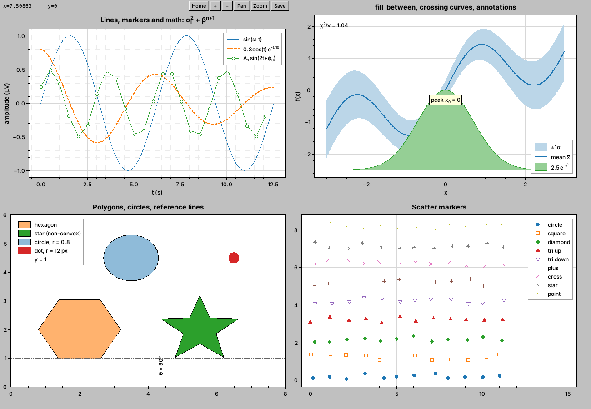
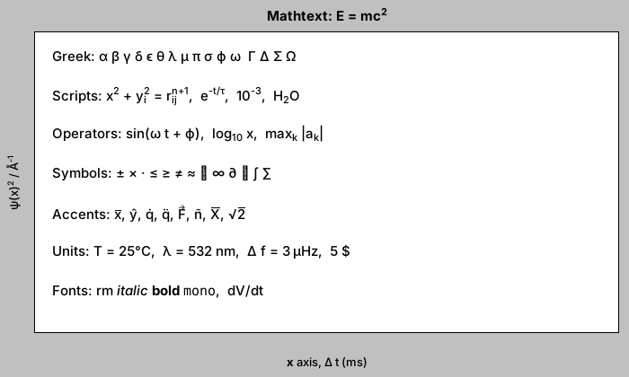

# Fl_Plot: native 2D plotting for FLTK

`Fl_Plot` is a small, fast plot widget for FLTK 1.4. It works like
`plot()` in MATLAB or pyplot, but as an ordinary FLTK widget meant for
on-screen use in scientific and engineering tools. It isn't trying to
replace matplotlib or produce print-quality figures.



* Line and scatter plots from one call, with matlab-style format strings
  (`"r--o"`) and per-item control of line color, style and width, and of
  marker shape, size, edge, face and edge width.
* Fill-between (crossing curves handled), filled or outlined polygons,
  circles (radius in data units or pixels), horizontal and vertical
  reference lines, and boxed or rotated text annotations.
* Any number of items in one set of axes, plus a legend, major and minor
  grid, major and minor ticks with automatic "nice" tick labels (common
  `×10^n` factor for very large or small values), a title, an xlabel and
  a ylabel.
* Math text in every label: `"$\alpha_i^2$ (\mu V)"`, with greek letters,
  sub/superscripts, symbols, accents and operator names.
* Large data: a 1,000,000-point line over 300 px sends about 1,200
  vertices to FLTK (details under [Performance](#performance)).
* Interaction: zoom in/out, reset, box zoom, pan, wheel zoom and
  keyboard. Each of these is an action method you can call from your own
  buttons or events. `default_interaction()` sets up a sensible default
  set of bindings, and `toolbar(true)` shows an optional built-in toolbar.
* `Fl_Plot_Window`: a ready-made plot window with a menu bar, toolbar and
  axes dialog, for handing a whole figure off to its own window as you
  would with a matplotlib figure.
* Event hook that reports the mouse in both screen and data coordinates.
* PNG capture (`save_png()`, or `save_png_dialog()` with a file chooser), or an `Fl_RGB_Image` for your own use.

## Building

You need FLTK **1.4** (it uses `Fl_Image_Surface`, `fl_write_png` and
rotated text) and CMake 3.15 or newer.

```sh
# with an installed FLTK 1.4
cmake -S . -B build -DCMAKE_PREFIX_PATH=/path/to/fltk-1.4
cmake --build build

# or let CMake download and build FLTK 1.4.4
cmake -S . -B build -DFL_PLOT_FETCH_FLTK=ON
cmake --build build

ctest --test-dir build      # the render test runs under xvfb-run when it is available
./build/demo                # four plots showing most features
./build/bigdata             # 1.2 million points, prints the redraw time
./build/custom_bindings     # everything wired by hand
./build/plot_window         # Fl_Plot_Window, blocking (add --app for pop-up windows)
```

The library is five source files (`src/`) and four headers (`include/`).
Linking against the `fltk_plot` target pulls in `fltk::fltk` and
`fltk::images`. You can also just drop the files into your own build.

## Quick start

```cpp
#include <FL/Fl.H>
#include <FL/Fl_Double_Window.H>
#include "Fl_Plot.H"

int main() {
  Fl_Double_Window win(640, 440, "plot");
  Fl_Plot *p = new Fl_Plot(0, 0, 640, 440);
  win.end();
  win.resizable(p);

  std::vector<double> t(500), y(500);
  for (int i = 0; i < 500; i++) { t[i] = i * 0.02; y[i] = sin(t[i]); }

  Fl_Plot_Line *l = p->plot(t, y, "b-");        // returns the item for further styling
  l->line_width(2);
  l->label("$\\sin(\\omega t)$");
  p->fill_between(&t[0], &y[0], 0.0, t.size(), 0.3)->label("area");
  p->text(1.57, 1.0, "peak")->box(true);

  p->title("Response");  p->xlabel("$t$ (s)");  p->ylabel("$V_{out}$ ($\\mu$V)");
  p->grid(true);  p->grid_minor(true);  p->legend(true);
  p->default_interaction();                      // mouse + keyboard
  p->toolbar(true);                              // Home + - Pan Zoom Save + x/y readout

  win.show();
  return Fl::run();
}
```

As with other FLTK widgets, call `p->redraw()` after changing data or style
outside of the event loop.

## API overview

All items are created with the convenience functions below or with `new`
followed by `add()`. Either way the plot owns the item and deletes it.

| Call | Item | Notes |
|---|---|---|
| `plot(x, y, n, fmt)`, `plot(xv, yv, fmt)`, `plot(yv)` | `Fl_Plot_Line` | `fmt`: colors `bgrcmykw`, styles `- -- : -.`, markers `o s d ^ v + x * .` |
| `plot_sampled(y, n, x0, dx, fmt)`, `plot_sampled(yv, x0, dx)` | `Fl_Plot_Line` | uniformly sampled signal: `y[i]` at `x0 + i*dx` (`dx = 1/fs` for a time axis) |
| `scatter(x, y, n, marker, size)` | `Fl_Plot_Line` | markers only |
| `fill_between(x, y1, y2, n, alpha)` | `Fl_Plot_Fill` | `y2` may be an array or a constant; `x` may be NULL (index) |
| `polygon(x, y, n, fill)` | `Fl_Plot_Polygon` | non-convex is fine; `coords(FL_PLOT_AXES)` for axes-fraction coordinates |
| `circle(cx, cy, r, fill, units)` | `Fl_Plot_Circle` | `FL_PLOT_DATA` radius (an ellipse when the x and y scales differ) or `FL_PLOT_PIXELS` |
| `axhline(y)`, `axvline(x)` | `Fl_Plot_Ref_Line` | infinite reference lines, not autoscaled |
| `text(x, y, str, coords)` | `Fl_Plot_Annotation` | align, angle, pixel offset, font, optional box |

Items are owned by the plot. `remove(item)` deletes one, and deleting an
item yourself also takes it out of its plot. `add()` with an item from
another plot moves it.

Line styling: `color()`, `line_style()` (`FL_SOLID`, `FL_DASH`, `FL_DOT`,
`FL_DASHDOT`, or `FL_PLOT_NO_LINE`), `line_width()`, `marker()`,
`marker_size()`, `marker_color()` (edge), `marker_fill_color()`,
`marker_filled()`, `marker_line_width()`. Every item also has `label()`
(the legend text), `visible()` and `autoscale()`.

Axes: `title()`, `xlabel()`, `ylabel()`, `grid()`, `grid_minor()`,
`grid_color()`, `minor_ticks()`, `ticks_inside()`, `tick_spacing()`,
`xticks()`/`yticks()` (explicit positions), `xtick_format()` (a callback,
for units or dates), `legend()`, `legend_position()`, `axes_color()`,
`textfont()`/`textsize()`.

Limits: `xlim(a, b)` and `ylim(a, b)` fix an axis, and `xlim_auto()` and
`ylim_auto()` turn autoscaling back on (`xlim_is_auto()` and
`ylim_is_auto()` report it). `view(x0, x1, y0, y1)` sets the
visible region. `xmin()` and the related calls read the current view.

Color cycle: new items take their colors in turn from the tab10 palette
(`Fl_Plot::cycle_color(i)`).

## Interaction

Each action is a public method, so your own buttons, menus or shortcuts can
call them:

```cpp
reset_zoom();  zoom_in(axes);  zoom_out(axes);  zoom(factor, cx, cy, axes);
zoom_to(x0, x1, y0, y1);  pan_pixels(dx, dy, axes);
zoom_box_begin(sx, sy);  zoom_box_update(sx, sy);  zoom_box_end(apply);
```

`default_interaction()` sets up these bindings:

| Input | Action |
|---|---|
| left drag | zoom box (a nearly flat box zooms x only; a nearly vertical one zooms y only) |
| middle or right drag, shift+left drag | pan |
| drag on the x or y tick labels | pan that axis only |
| wheel | zoom about the cursor; over an axis, or with shift/ctrl, zoom x/y only |
| double click | reset zoom |
| `r` / Home, `+` / `-`, arrows | reset, zoom, pan |
| `g`, `l` | toggle grid, toggle legend |
| `p`, `z`, Esc | left drag pans, left drag zooms, cancel zoom box |

You can also set each binding separately: `drag_mode(button, FL_PLOT_DRAG_ZOOM_BOX |
FL_PLOT_DRAG_PAN | FL_PLOT_DRAG_NONE)`, `wheel_zoom()`,
`double_click_reset()`, `keyboard()`. `no_interaction()` clears them all,
which is the default for a new plot.

`event_callback(cb, data)` installs a hook that sees every mouse and key
event before the default handling, and can consume an event by returning
non-zero. It receives an `Fl_Plot_Event`:

```cpp
struct Fl_Plot_Event {
  int event, button, clicks, state, key, wheel_dx, wheel_dy;
  int sx, sy;            // window coordinates (as Fl::event_x())
  double x, y;           // data coordinates
  Fl_Plot_Region region; // FL_PLOT_IN_AXES, FL_PLOT_IN_XAXIS, FL_PLOT_IN_YAXIS, FL_PLOT_OUTSIDE
};
```

`view_callback(cb, data)` fires whenever the limits change. You can use it
to link axes between plots; `examples/custom_bindings.cxx` shows both
callbacks. For your own coordinate math there are `data_to_screen()`,
`screen_to_data()`, `axes_box()` and `region()`.

## Plot window

When an application just wants to show a plot and leave the rest to the
window, use `Fl_Plot_Window` (`#include "Fl_Plot_Window.H"`). It is an
`Fl_Double_Window` holding one `Fl_Plot` below a menu bar, with the plot
toolbar and `default_interaction()` already on. `axes()` returns the plot.

```cpp
// Blocking, like plt.show(): run() returns when the window is closed.
Fl_Plot_Window win(800, 560, "Response");
win.axes()->plot(t, y, "b-")->label("output");
win.axes()->xlabel("$t$ (s)");
win.run();
```

```cpp
// Fire and forget, from an application that already runs Fl::run().
Fl_Plot_Window *w = new Fl_Plot_Window(800, 560, "Spectrum");
w->delete_on_close(true);          // deletes itself when the user closes it
w->axes()->plot(f, mag);
w->show();
```

| Menu | Items |
|---|---|
| File | Save as PNG… (Ctrl/Cmd+S), Close (Ctrl/Cmd+W) |
| View | Reset view (`r`), Zoom in (`+`), Zoom out (`-`), Grid (`g`), Minor grid, Legend (`l`), Toolbar |
| Tools | Zoom box (`z`) / Pan (`p`) for left drag, Axes… (Ctrl/Cmd+E): title, labels and limits |
| Help | Mouse and keys… |

Other calls: `run()` (safe with `delete_on_close(true)`), `close()`,
`close_callback(cb, data)` (called before the window is hidden and
deleted), `save_dialog()`, `axes_dialog()`, `help_dialog()`. `menubar()`
returns the `Fl_Menu_Bar`, so you can add your own entries next to the
built-in ones. Esc cancels a zoom box and does not close the window.
`examples/plot_window.cxx` shows both uses.

## Performance

Two things keep drawing cheap no matter how much data there is:

1. **Sorted x (the usual case for signals): min/max per pixel column.**
   When data is set, the library checks once whether x is finite and
   non-decreasing, and if so builds a block min/max tree over y (O(n) time,
   about n/16 extra doubles of memory). On each view change it uses binary
   search to find the visible index range. If that range holds more than
   about 4 points per pixel, it walks the pixel columns and emits each
   column's first, min, max and last values (the "M4" scheme). Each
   min/max lookup costs O(64 + log n). The result looks the same as
   drawing every point, because every column still spans exactly the
   same [min, max]; `tests/test_algo.cxx` checks this column by column.
   When you zoom in far enough that the visible points are sparse, every
   point is drawn exactly.
2. **Markers: one per occupied pixel.** Marker positions go through an
   occupancy grid the size of the axes, so 10⁶ scatter points become at
   most W×H markers.

Unsorted lines drop consecutive points that land in the same pixel. The
screen geometry of each item is cached against the transform, so redraws
that don't change the view (zoom box rubber band, toolbar, expose) skip
the data entirely. Fill-between uses the same per-column approach on the
lower and upper envelopes.

Measured on the development container (software X server, offscreen):

| | |
|---|---|
| 10⁶-point min/max tree build | ~2 ms |
| 10⁶ → 300 px decimation | ~0.2 ms, 1,201 vertices |
| 10⁶ line + 2×10⁵ scatter, full redraw while panning | ~7.5 ms |
| same, cached | ~5 ms (mostly drawing 58k point markers) |

All geometry is clipped in floating point before it reaches FLTK, so deep
zooms can't overflow X11's 16-bit coordinates. NaN values in y break the
line, which you can use to show gaps.

## Math text

Text outside `$...$` is drawn as-is. Inside `$...$` the renderer
understands a TeX subset modelled on matplotlib's mathtext:



* `x^2`, `x_{ij}`, `x_i^2` (stacked), nested scripts
* `\alpha` … `\Omega` and about 120 symbols in all (`\pm \times \leq \approx \infty \partial \nabla \int \sum \degree \AA \hbar` …)
* `\sin \cos \log \exp \max` … drawn upright, `\mathrm \mathit \mathbf \mathtt`
* `\bar \hat \dot \ddot \vec \tilde`, `\sqrt{}`, `\frac{a}{b}` (shown inline as a/b)
* spacing `\, \; \quad \!`, escapes `\{ \} \$ \_`

It is about 400 lines, has no dependencies, and is available on its own as
`Fl_Plot_Text` for use in your own widgets. Glyphs come from the font
through Xft, which does no per-glyph fallback. If your sans font lacks
some symbols, route symbols to a font that has them:

```cpp
Fl::set_font(FL_FREE_FONT, "DejaVu Sans");
Fl_Plot_Text::symbol_font(FL_FREE_FONT);
```

**About external math libraries:** I chose not to depend on one for now.
The best fit, if full TeX math is ever needed (real fractions, roots,
matrices, big operators with limits), is **MicroTeX**
(github.com/NanoMichael/MicroTeX, MIT license, C++). It would need a small
FLTK `Graphics2D` backend and an OpenType math font. Since every label goes
through `Fl_Plot_Text`, it could be swapped in behind that one class
without changing the plot API. The built-in subset covers the axis-label
and legend use cases with no new dependency and no font files to ship.

## Notes and limitations

* **Antialiasing:** FLTK's default X11 backend draws aliased lines (text is
  antialiased through Xft). If you build FLTK with
  `-DFLTK_GRAPHICS_CAIRO=ON`, all drawing goes through Cairo and lines are
  antialiased, with no change to this library. Windows (GDI+) and macOS
  (Quartz) antialias already.
* **Transparency** (`alpha()` on fills, polygons and circles) is emulated
  by blending with the axes background, because FLTK has no alpha fill.
  Overlapping translucent items therefore cover each other instead of
  mixing.
* Linear axes only for now. Log axes, a second y axis, images and
  colorbars, and date axes are natural next steps. The transform is
  isolated in `Fl_Plot_Algo::Xform`, so log scaling is a contained change.
* One `Fl_Plot` holds one set of axes. For subplots, use several widgets
  (for example in an `Fl_Flex` or `Fl_Grid`).
* `Fl_Plot` derives from `Fl_Group` only to host its toolbar buttons.
  Don't `add()` your own widgets to it.

## Licensing

FLTK is LGPL-2 with a static-linking exception, which is compatible with
both internal and open-source use. This code doesn't copy from gnuplot,
whose license is non-standard and allows distributing modified versions
only as patches. The algorithms here (nice ticks, M4/min-max decimation,
Liang-Barsky and Sutherland-Hodgman clipping) are standard and were
written from scratch, so the project is free to pick its own license.
None has been chosen yet.
